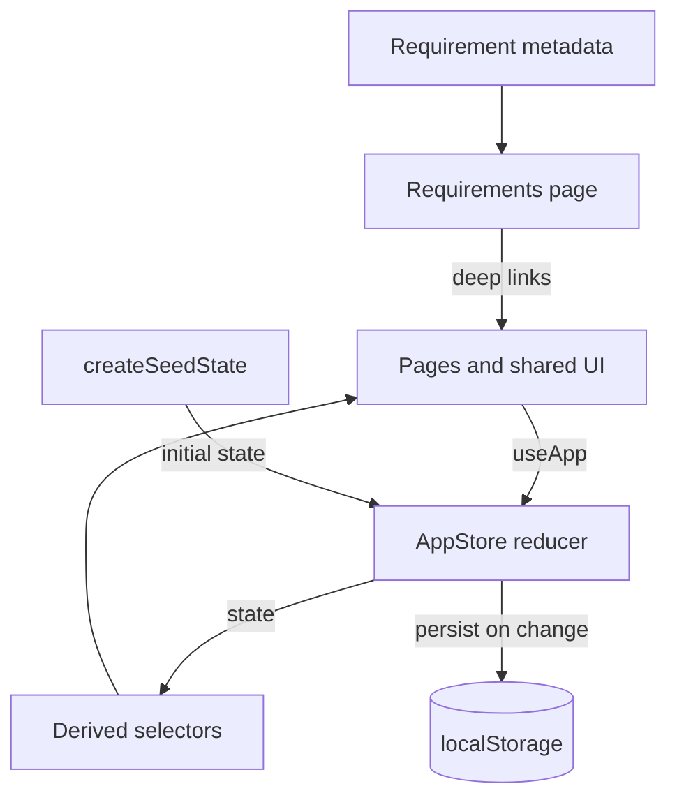

# Architecture

This document describes how the demo is structured, how data flows through it, and which trade-offs were made for a browser-only demonstration.

## Goals

- Demonstrate every one of the 22 requirements with a complete, clickable workflow.
- Keep the app runnable with `npm install && npm run dev` — no backend, accounts or environment variables.
- Use BoardUI components and design tokens rather than a bespoke visual system.
- Keep state transitions explicit and testable so the demo can later be replaced with API calls.

## High-level shape



There is no network layer. Every action is a synchronous reducer transition over an in-memory `AppState`.

## Entry points

| File | Responsibility |
|---|---|
| `src/main.tsx` | Mounts React and imports BoardUI global styles |
| `src/App.tsx` | Wraps the app in `AppProvider`, renders `AppShell`, routes pages, redirects when a role loses access |
| `src/components/AppShell.tsx` | Sidebar, header, role switcher, theme toggle, mobile navigation, reset dialog |
| `src/store/AppStore.tsx` | Context provider, reducer, actions and persistence |
| `src/lib/seed.ts` | Deterministic sample data, seeded relative to the current date |
| `src/lib/selectors.ts` | Derived values used by pages |

## State model

`AppState` (in `src/lib/types.ts`) is a single JSON-serializable object:

```ts
interface AppState {
  role: Role;
  skus: SKU[];
  locations: StockLocation[];
  stock: StockRow[];
  movements: Movement[];
  combos: Combo[];
  distributors: Distributor[];
  demoIssues: DemoIssue[];
  packaging: PackagingItem[];
  packagingStock: PackagingStockRow[];
  packagingIssues: PackagingIssue[];
  orders: SalesOrder[];
  pis: PI[];
  claims: Claim[];
  customers: Customer[];
  leads: Lead[];
  vendors: Vendor[];
  purchaseOrders: PurchaseOrder[];
  receipts: Receipt[];
}
```

### Key modelling decisions

- **Stock is a SKU × location ledger.** Each `StockRow` has `onHand` and `reserved`. Available quantity is always `onHand - reserved`, clamped at zero. There is no separate "available" field to drift out of sync.
- **Movements are append-only.** Dispatch, receipt, demo and packaging actions write a movement with a type, quantity, route, reference and optional note. The daily report is derived from movements plus current stock.
- **Draft PIs reserve stock.** Creating a PI reserves `available` quantity at the warehouse. Dispatching subtracts both `onHand` and `reserved`, then writes a dispatch movement. This guarantees a draft PI cannot be double-sold.
- **Vendor dispatch does not move stock.** Only `receive-po` changes inventory. Receipts are stored separately, and PO line quantities are updated from accepted quantities.
- **Demo stock lives in an inventory location.** Issuing moves units from warehouse to the demo pool; consuming removes them from the pool; returning moves them back to the warehouse.
- **Packaging has its own location ledger.** Packaging is not mixed into SKU stock. Office consumption has its own issue records and balance.
- **Combos are derived, never stored.** Availability is `min(floor(available component qty / component qty))` across components, so shared components cannot be counted twice.
- **Claims keep each reimbursement component.** A claim stores the distributor sales value plus scheme, damage and additional customer-discount rates separately, so the total can be reconciled and audited.

## Reducer actions

All writes go through `src/store/AppStore.tsx`:

| Action | Effect |
|---|---|
| `set-role` | Switches the demo role and therefore navigation/data visibility |
| `create-pi` | Creates a draft PI from an order, reserves available warehouse stock, sets the order status (`PI drafted`, `Partially available`, `Backorder`) |
| `dispatch-pi` | Marks the PI dispatched, reduces on-hand and reserved stock, writes dispatch movements, fulfils or backorders the order |
| `receive-po` | Accepts quantities per PO line, increases SKU or packaging stock, writes inward movements, stores a receipt, updates PO status |
| `update-po-status` | Moves a PO through the vendor lifecycle and records `lastUpdated` |
| `revise-po-date` | Stores a revised delivery date |
| `issue-demo` | Moves stock from warehouse to demo pool and creates a demo issue |
| `consume-demo` | Removes outstanding demo quantity from the pool and writes a consumption movement |
| `return-demo` | Moves outstanding demo quantity back to the warehouse |
| `issue-packaging` | Reduces packaging at a location and records an issue |
| `add-lead`, `update-lead`, `advance-lead`, `import-instagram` | CRM lead operations |
| `mark-repeat` | Updates last order date, reorder due date and repeat status |
| `generate-claim`, `approve-claim` | Creates and approves distributor claim statements covering scheme, damage and additional customer-discount reimbursements |
| `reset` | Rebuilds the seed state and clears persisted data |

## Selectors

`src/lib/selectors.ts` contains pure functions so pages stay presentational:

- `availableAt`, `stockAt`, `reservedAt`, `totalOnHand`
- `comboAvailability`
- `distributorSummary`
- `poPendingQty`, `effectiveDelivery`, `poIsOverdue`, `poFollowUp`
- `repeatStatusFor`
- `forecastByMonth` / salesperson projections
- `visiblePages`, `canSeeCost` for role-based access

Selectors are recomputed during render. The data set is intentionally small, so memoisation is unnecessary.

## Persistence

- Key: `anitas-fms-demo-v2`
- Written after every state change in `AppProvider`.
- Read once during provider initialisation.
- If storage is unavailable or corrupt, the app falls back to seed data.
- **Reset** removes the key and dispatches `reset`.

Because state is a plain object, it can be exported, diffed, or replaced with server responses when the demo becomes a real application.

## UI architecture

### Pages and navigation

`App.tsx` keeps `page` and `tab` in local state. `visiblePages(role)` filters navigation. If the current page is not allowed for a role, the app redirects to the first allowed page. The URL is not used for routing; this keeps the demo portable as a static build.

### Shared UI

`src/components/ui.tsx` provides:

- `PageHeader`, `SectionHeader`, `Card`
- `Metric`, `Bar`
- `StatusChip` with a semantic status → colour mapping
- `DataTable` built on the BoardUI table primitives
- `EmptyState`, `Callout`, `LinkAction`

`DataTable` uses unique `${row.id}-${column.id}` cell keys because React Aria treats table rows, columns and cells as collections and requires globally unique keys.

### BoardUI integration

- Components are installed as source under `components/`.
- Global tokens, typography and table styles live in `styles/`.
- `cx()` from `utils/cx.ts` merges Tailwind classes and understands BoardUI composite type utilities.
- Imports use the same `@/components/...` paths as BoardUI documentation.

## Formatting and dates

`src/lib/format.ts` provides INR formatting, compact numbers, date formatting and relative date labels. Seed data uses `addDays(todayISO(), n)` so the demo always looks current, regardless of when it is opened.

## Build and tooling

- `vite.config.ts` enables React and Tailwind v4 and defines the split aliases described in the README.
- TypeScript 7 no longer supports `baseUrl`; `tsconfig.app.json` uses explicit `paths` instead.
- `npm run lint` runs oxlint.
- `npm run build` runs `tsc -b` followed by `vite build`.

## Security and production notes

This is a front-end demo. Before production use:

1. Replace localStorage with an authenticated API and database.
2. Enforce roles and cost visibility on the server, not only in the UI.
3. Add audit trails and immutable movement records.
4. Integrate Rupyz orders, Miracle billing and Meta lead sources behind server-side adapters.
5. Add reconciliation jobs for distributor and packaging stock.
6. Add tests around reducer transitions and stock invariants.
7. Split the bundle and add error boundaries.
